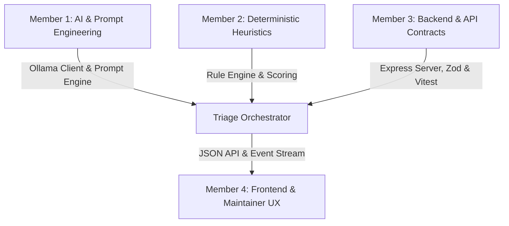

# PRoof — Team Ownership Boundaries (4 Members)

For our Hacktoberfest Hack Day Track 1 team, responsibilities are cleanly split across four modular boundaries to enable parallel work, strict interface contracts, and regression-free integration.

---

## 👤 Member 1: AI Pipeline & Prompt Engineering
**Primary Focus:** Local Ollama runtime, model inference, prompt injection prevention, and structured output formatting.

- **Owned Modules:**
  - `backend/src/ai/ollama-client.ts`
  - `backend/src/ai/prompt-builder.ts`
  - `backend/src/ai/fallback-generator.ts`
- **Core Responsibilities:**
  1. Integrate with local Ollama daemon (`http://localhost:11434`) targeting Qwen 3.5 4B / Qwen 2.5 3B (Q4_K_M).
  2. Implement prompt isolation guards using untrusted input delimiters (`<UNTRUSTED_PR_DIFF>`) to neutralize prompt injection attacks inside malicious PR descriptions or diffs.
  3. Enforce valid JSON schema returns from Ollama with strict parsing and error recovery.
  4. Build the deterministic fallback generator that produces polite, actionable, and clearly labeled heuristics-only verdicts whenever Ollama is unavailable.
  5. Ensure zero code execution occurs during diff analysis.

---

## 👤 Member 2: Deterministic Heuristics & Evidence Extraction
**Primary Focus:** Fast, explainable rule engine that analyzes pull requests without relying on probabilistic models.

- **Owned Modules:**
  - `backend/src/heuristics/whitespace.ts`
  - `backend/src/heuristics/diff-size.ts`
  - `backend/src/heuristics/issue-link.ts`
  - `backend/src/heuristics/template-check.ts`
  - `backend/src/heuristics/index.ts`
- **Core Responsibilities:**
  1. Build AST-unaware and regex-based whitespace detectors to identify diffs with only indentation, newline, or trailing space changes.
  2. Calculate code complexity metrics: addition-to-deletion ratio, test file existence vs implementation file changes, and single-file vs multi-file scope.
  3. Inspect PR description for standard checklist completion (`- [x]`) and issue cross-references (`Closes #...`, `Fixes #...`).
  4. Generate clear `HeuristicFinding` records with positive or penalty score weights.
  5. Extract verifiable line numbers and diff evidence without hallucination.

---

## 👤 Member 3: Backend Architecture, Validation & Testing
**Primary Focus:** REST API server, data integrity, pipeline orchestration, and end-to-end unit tests.

- **Owned Modules:**
  - `shared/src/types.ts` & `shared/src/schemas.ts`
  - `backend/src/pipeline/triage-pipeline.ts`
  - `backend/src/samples/sample-store.ts`
  - `backend/src/routes/triage.ts`
  - `backend/src/app.ts` & `backend/src/server.ts`
  - `backend/tests/*`
- **Core Responsibilities:**
  1. Define and maintain shared TypeScript types and Zod schemas across the monorepo.
  2. Build the Express.js API server with CORS, JSON body parsing, and route handlers.
  3. Curate and validate the three benchmark sample PRs (`samples/genuine-pr.json`, `samples/needs-work-pr.json`, `samples/likely-spam-pr.json`).
  4. Coordinate the triage pipeline: PR Input ➔ Heuristics ➔ AI Inference / Fallback ➔ Evidence Consolidation ➔ Suggested Comment.
  5. Provide comprehensive Vitest test coverage for all heuristics, API routes, and fallback states.

---

## 👤 Member 4: Frontend Application & Maintainer UX
**Primary Focus:** Modern, accessible, responsive web interface for open-source maintainers.

- **Owned Modules:**
  - `frontend/src/components/*`
  - `frontend/src/App.tsx`
  - `frontend/src/index.css`
  - `frontend/src/api-client.ts`
- **Core Responsibilities:**
  1. Build a modern React + Vite + Tailwind CSS dashboard with dark mode and high-contrast typography.
  2. Implement the Sample PR quick-selector with live previews of Genuine, Needs Work, and Likely Spam PRs.
  3. Render side-by-side diff viewers with syntax highlighting and line numbers.
  4. Display AI verdict badges, confidence scores, and heuristic findings cards.
  5. Provide an editable review comment editor allowing maintainers to modify the suggested polite comment before approving.
  6. Present live Ollama connectivity indicators (Green: "Ollama Active", Amber: "Heuristics-Only Mode (Ollama Offline)").
